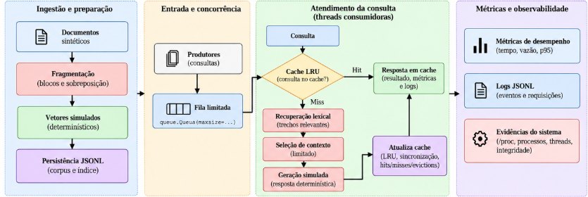
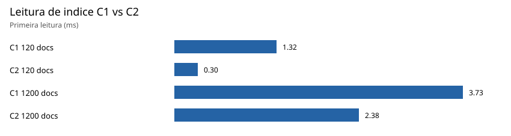
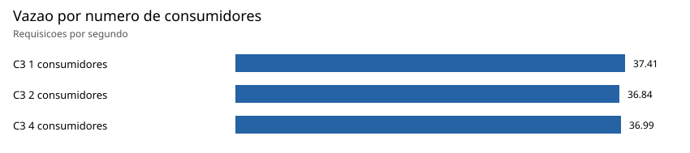

# GenResearch-Servidor

**Sistemas Operacionais 2026.2 - AV2**

**Discente:** Roberdan Tamyr dos Santos Feitosa Junior 
**Relatório técnico:** [https://github.com/LeeYooBin/ufs-so-2026-2-av2-genresearch/tree/main/docs/relatorio.pdf](https://github.com/LeeYooBin/ufs-so-2026-2-av2-genresearch/tree/main/docs/relatorio.pdf)  
**Vídeo de demonstração:** link 
**Guia do vídeo:** [https://github.com/LeeYooBin/ufs-so-2026-2-av2-genresearch/tree/main/docs/VIDEO.md](https://github.com/LeeYooBin/ufs-so-2026-2-av2-genresearch/tree/main/docs/VIDEO.md)  
**Declaração de uso de IA:** [https://github.com/LeeYooBin/ufs-so-2026-2-av2-genresearch/tree/main/docs/declaracao_de_uso_ia.pdf](https://github.com/LeeYooBin/ufs-so-2026-2-av2-genresearch/tree/main/docs/declaracao_de_uso_ia.pdf)

## 1. Visão geral

O projeto implementa um pipeline de recuperação simulada de informações. Seu objetivo não é construir um modelo de inteligência artificial, mas reproduzir componentes de uma aplicação inspirada em RAG para analisar mecanismos de Sistemas Operacionais.

O sistema realiza:

- Geração de documentos sintéticos.
- Fragmentação dos documentos em *chunks*.
- Geração de vetores simulados e determinísticos.
- Persistência do corpus e do índice em arquivos JSONL.
- Leitura convencional e leitura com `mmap`.
- Processamento de consultas com produtores e consumidores.
- Comunicação por fila limitada.
- Recuperação lexical e seleção de contexto limitado.
- Geração simulada de respostas.
- Cache LRU compartilhado e sincronizado.
- Registro de métricas, logs e evidências do Linux.

não são utilizados LLMs, Ollama ou GPU para inferência. Os vetores simulados não são empregados em uma busca vetorial real; a recuperação é lexical. A simulação permite concentrar os experimentos nos recursos administrados pelo sistema operacional.

## 2. Arquitetura



*Visão geral dos componentes de ingestão, persistência, concorrência, recuperação, cache e observabilidade.*

### 2.1 Preparação dos dados

Os documentos sintéticos são fragmentados e recebem vetores determinísticos simulados. O corpus e o índice são persistidos em JSONL, permitindo comparar diferentes estratégias de acesso aos dados.

Na configuração de referência, **120 documentos produzem 480 chunks**, com fragmentos de 40 palavras, sobreposição de oito palavras e vetores simulados de 16 dimensões.

### 2.2 Processamento das consultas

O caminho principal é:

**Produtores → fila limitada → consumidores → cache LRU → recuperação lexical em caso de miss → contexto limitado → resposta simulada → métricas e logs.**

A fila utiliza `queue.Queue(maxsize=...)`, permitindo observar o comportamento de produtores e consumidores sob capacidade limitada.

O cache é compartilhado entre as threads consumidoras. A implementação principal utiliza lock global para proteger o acesso e evitar cálculos duplicados, enquanto uma demonstração isolada compara essa estratégia com um cache sem sincronização e outro com lock por chave.

### 2.3 Observabilidade

O projeto registra métricas da aplicação e informações do sistema operacional, incluindo:

- Tempos de execução, latência e vazão.
- Hits, misses e expulsões do cache.
- Ocupação da fila e integridade das requisições.
- RSS, VSZ e faltas de página.
- Contadores de entrada e saída.
- Eventos estruturados em JSONL.
- Processos, threads e informações de memória disponibilizadas por `/proc`.

## 3. Ambiente experimental

| Componente | Configuração |
|---|---|
| Sistema operacional | Ubuntu 24.04.3 LTS sob WSL2 |
| Kernel | `6.6.87.2-microsoft-standard-WSL2` |
| Linguagem | Python 3.12.3 |
| Processador | AMD Ryzen 7 7735HS |
| CPU | 8 núcleos físicos e 16 processadores lógicos |
| RAM disponibilizada ao WSL | Aproximadamente 15 GiB |
| Swap | 4 GiB |
| Armazenamento dos benchmarks definitivos | `ext4`, na distribuição WSL |
| GPU | Não utilizada |

Os **39 benchmarks definitivos foram executados no sistema de arquivos `ext4`** da distribuição Linux. A coleta complementar de observabilidade ocorreu em `/mnt/c`, no sistema de arquivos montado do Windows, e seus tempos não foram incorporados às medições definitivas.

As evidências do ambiente estão disponíveis em [docs/evidencias/etapa6_os/](docs/evidencias/etapa6_os/), [lscpu.txt](docs/evidencias/lscpu.txt) e [lsblk.txt](docs/evidencias/lsblk.txt), quando presentes no repositório.

## 4. Instalação e execução

### 4.1 Pré-requisitos

- Linux ou WSL2.
- Python 3.12 ou versão compatível.
- Git.

Na raiz do repositório:

```bash
python3 -m venv .venv
source .venv/bin/activate
python -m pip install -r requirements.txt
```

### 4.2 Testes automatizados

```bash
python -m unittest discover -s tests -v
```

Na validação final da implementação foram executados **17 testes automatizados**, todos aprovados.

### 4.3 Gerar corpus e índice

```bash
python scripts/run_ingestion.py \
  --documents 120 \
  --mode standard
```

Para executar a leitura com `mmap`:

```bash
python scripts/run_ingestion.py \
  --documents 120 \
  --mode mmap
```

### 4.4 Executar o serviço concorrente

```bash
python scripts/run_service.py \
  --requests 40 \
  --unique-queries 5 \
  --producers 2 \
  --consumers 4 \
  --queue-capacity 2 \
  --cache-capacity 8 \
  --response-ms 20
```

A execução produz métricas de processamento e resultados em `results/raw/service.json`.

### 4.5 Demonstração de sincronização

```bash
python scripts/run_race_demo.py
```

Compara o comportamento do cache sem proteção, com lock global e com lock por chave.

### 4.6 Coleta complementar de observabilidade

```bash
python scripts/run_observability.py \
  --documents 120 \
  --requests 40 \
  --unique-queries 5 \
  --producers 2 \
  --consumers 4 \
  --queue-capacity 2 \
  --cache-capacity 8 \
  --response-ms 20
```

A execução gera métricas complementares e logs estruturados.

### 4.7 Reproduzir os benchmarks

```bash
python scripts/run_benchmarks.py --repetitions 3
```

Esse comando executa a matriz experimental completa. Para uma verificação reduzida, existe a opção `--quick`.

**Os resultados apresentados a seguir correspondem às medições já realizadas.** Não é necessário reproduzir as 39 execuções durante a apresentação.

## 5. Metodologia experimental

Foram executadas **13 configurações, com três repetições por configuração**, totalizando **39 medições definitivas**.

Os fatores variados incluíram modo de leitura, tamanho do corpus, número de consumidores, capacidade do cache e diversidade das consultas.

| Caso | Objetivo |
|---|---|
| C1 | Avaliar leitura convencional |
| C2 | Avaliar leitura utilizando `mmap` |
| C3 | Investigar concorrência e número de consumidores |
| C4 | Avaliar reutilização e capacidade do cache |
| C5 | Observar consumo de memória com corpus maior |
| C6 | Avaliar falhas controladas e comportamento da fila |

Os resultados completos estão disponíveis em [benchmark_summary.csv](results/metrics/benchmark_summary.csv) e [benchmark_av2.json](results/raw/benchmark_av2.json).

## 6. Resultados experimentais

### 6.1 C1–C2: leitura convencional e mmap

| Documentos | Leitura convencional | `mmap` |
|---:|---:|---:|
| 120 | 3,383 ms | 0,914 ms |
| 1.200 | 8,132 ms | 5,242 ms |



A leitura com `mmap` apresentou menor tempo médio nos dois tamanhos avaliados. Entretanto, com 1.200 documentos, as medianas foram próximas: **5,239 ms na leitura convencional e 5,272 ms com `mmap`**.

Isso impede concluir que `mmap` foi consistentemente superior em todas as execuções. Além disso, a implementação utiliza `mmap[:]`, produzindo uma cópia em bytes, sem acesso *zero-copy*.

### 6.2 C3: concorrência e consumidores

| Consumidores | Vazão média | Latência p95 |
|---:|---:|---:|
| 1 | 37,41 req/s | 292,11 ms |
| 2 | 36,84 req/s | 345,04 ms |
| 4 | 36,99 req/s | 486,27 ms |



O aumento do número de consumidores **não produziu ganho de vazão** nessa configuração.

O principal gargalo identificado foi o lock global do cache, mantido durante o cálculo de consultas não armazenadas. Com 40 consultas distintas, o processamento permaneceu amplamente serializado, mesmo com mais threads disponíveis.

### 6.3 C4: cache compartilhado

| Capacidade do cache | Consultas distintas | Taxa de hits | Vazão média |
|---:|---:|---:|---:|
| 2 | 5 | 7,5% | 39,89 req/s |
| 8 | 5 | 87,5% | 290,32 req/s |
| 8 | 40 | 0% | 37,32 req/s |


Quando cinco consultas distintas couberam no cache de capacidade oito, a taxa de acerto atingiu **87,5%**, com vazão aproximadamente **7,28 vezes maior** que a configuração com capacidade dois.

Quando todas as consultas foram distintas, não houve hits. O resultado demonstra que a eficácia do cache depende do padrão de reutilização e do tamanho do conjunto de trabalho.

### 6.4 C5: memória virtual e pressão de memória

| Corpus | RSS final médio | Faltas minor médias | Faltas major |
|---:|---:|---:|---:|
| 120 documentos | 20.540 KiB | 395,7 | 0 |
| 1.200 documentos | 32.542,7 KiB | 3.986,3 | 0 |

O aumento do corpus elevou a memória residente ao final da execução e a quantidade de faltas de página *minor*.

Não foram observadas faltas *major* nem utilização de swap nesses cenários. Portanto, os resultados não demonstram *thrashing* ou paginação intensa em disco.

### 6.5 C6: falhas controladas

Foram avaliados o comportamento diante de índice ausente e o funcionamento de uma fila de capacidade limitada.

A instrumentação complementar também registrou uma falha controlada do tipo `FileNotFoundError`, seguida de encerramento normal do processo.

## 7. Condição de corrida e sincronização

Uma demonstração isolada comparou três estratégias de cache:

- **Sem sincronização:** permite cálculos redundantes para uma mesma chave.
- **Lock global:** impede duplicações, mas pode serializar consultas independentes.
- **Lock por chave:** impede duplicações por entrada sem bloquear todas as chaves distintas.

Com oito threads acessando a mesma chave, o cache inseguro realizou oito cálculos redundantes. As variantes sincronizadas realizaram um cálculo e sete reutilizações.

Com oito chaves distintas, os tempos médios foram:

| Estratégia | Tempo médio |
|---|---:|
| Lock global | 358,78 ms |
| Lock por chave | 47,16 ms |

O lock global foi aproximadamente **7,61 vezes mais lento** nesse cenário.

Dados completos: [race_demo.json](results/raw/race_demo.json).

## 8. Evidências do Linux e observabilidade

### 8.1 Processos, threads e integridade

Em uma execução de observação com dois produtores, quatro consumidores e fila de capacidade dois, foram registrados:

| Indicador | Resultado |
|---|---:|
| Threads do processo | 7 |
| Requisições submetidas | 80 |
| Requisições concluídas | 80 |
| Perdas | 0 |
| Duplicações | 0 |
| Erros | 0 |
| Ocupação máxima da fila | 2 |

As sete threads correspondem à thread principal, duas produtoras e quatro consumidoras.

A coleta também registrou `VmRSS`, `VmSize`, `VmHWM`, informações de memória e contadores disponibilizados pelo Linux.

Evidências: [docs/evidencias/etapa6_os/](docs/evidencias/etapa6_os/).

### 8.2 Logs estruturados

A coleta complementar da Etapa 6.5 utilizou 40 requisições, cinco consultas distintas, dois produtores, quatro consumidores, fila de capacidade dois e cache de capacidade oito.

Foram observados:

| Indicador | Resultado |
|---|---:|
| Requisições concluídas | 40/40 |
| Hits do cache | 35 |
| Misses | 5 |
| Taxa de hits | 87,5% |
| Vazão | 247,28 req/s |
| Tempo de ingestão | 19,879 ms |
| Ocupação média amostral da fila após `put` | 1,925 |

Os logs JSONL registram ingestão, consultas, hits e misses, recuperação, geração simulada, conclusão, falha controlada e encerramento.

**Essa execução é complementar e não integra os 39 benchmarks definitivos.**

Métricas: [etapa6_5_observability.json](results/raw/etapa6_5_observability.json).  
Eventos: [etapa6_5_events.jsonl](logs/etapa6_5_events.jsonl).

## 9. Resultados e arquivos para consulta

| Arquivo ou diretório | Conteúdo |
|---|---|
| [benchmark_summary.csv](results/metrics/benchmark_summary.csv) | Resumo das 13 configurações |
| [benchmark_av2.json](results/raw/benchmark_av2.json) | Medições individuais |
| [results/plots/](results/plots/) | Gráficos dos experimentos |
| [race_demo.json](results/raw/race_demo.json) | Demonstração de sincronização |
| [docs/evidencias/etapa6_os/](docs/evidencias/etapa6_os/) | Evidências do Linux |
| [etapa6_5_observability.json](results/raw/etapa6_5_observability.json) | Métricas complementares |
| [etapa6_5_events.jsonl](logs/etapa6_5_events.jsonl) | Logs estruturados |
| [VIDEO.md](/docs/VIDEO.md) | Vídeo e demonstração |
| [declaracao_de_uso_ia.pdf](/docs/declaracao_de_uso_ia.pdf) | Declaração de uso de IA |

Os arquivos JSON e JSONL permitem auditar os experimentos, mas os resultados principais já estão consolidados nas tabelas e gráficos deste README e no relatório técnico.

## 10. Conclusões e limitações

Os resultados demonstram que:

- `mmap` apresentou vantagens médias em algumas condições, sem superioridade consistente em todas as repetições.
- Aumentar o número de consumidores não melhorou a vazão quando o lock global serializou o processamento.
- O cache trouxe ganhos expressivos quando houve reutilização suficiente das consultas.
- O corpus maior elevou o consumo de memória, sem evidência de uso de swap ou paginação intensa em disco.
- A sincronização evitou cálculos duplicados, mas a granularidade do lock influenciou o desempenho.

O estudo utiliza corpus sintético, embeddings e respostas simulados, recuperação lexical e três repetições por configuração. Os resultados foram obtidos em WSL2 e não devem ser extrapolados diretamente para serviços RAG comerciais ou modelos de linguagem de grande porte.

**Conclusão central:** correção, desempenho e escalabilidade são propriedades distintas. A sincronização é necessária para preservar a consistência, mas a escolha dos mecanismos e a forma de acesso aos dados determinam os gargalos observados.

Para metodologia completa, análise crítica e referências, consulte o relatório técnico.